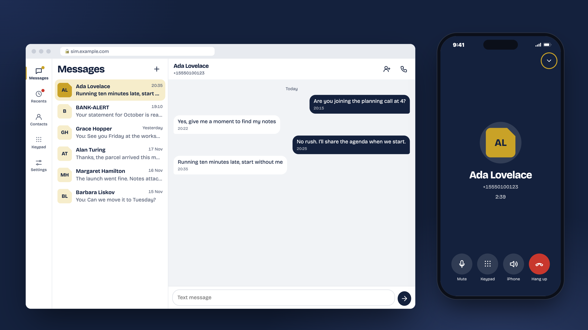
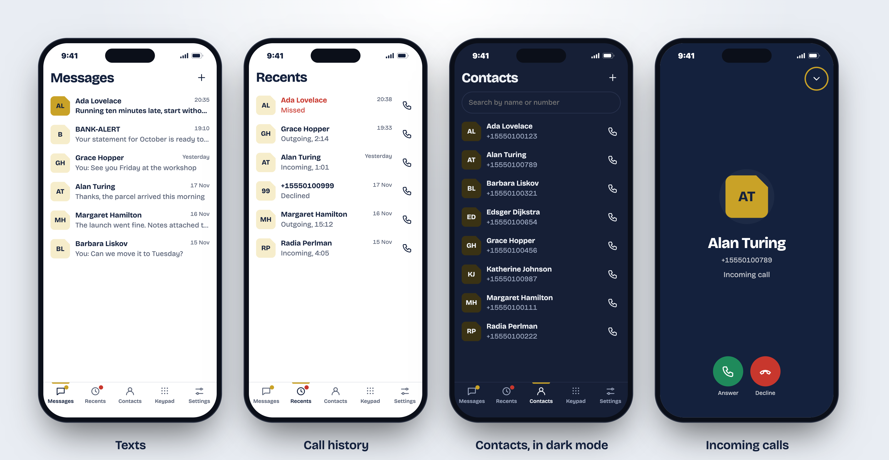
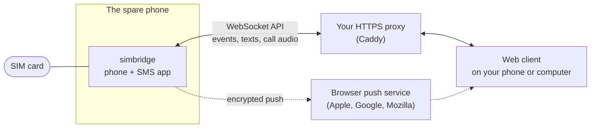

<p align="center">
  
</p>

<h1 align="center">simbridge</h1>

<p align="center">
  <b>Your spare Android phone's SIM, in a browser.</b><br>
  Make and take its calls, send and read its texts, and get notified, from anywhere on your private network.
</p>

<p align="center">
  <a href="https://github.com/mukhtharcm/simbridge/releases/latest"></a>
  <a href="LICENSE"></a>
  
</p>

<p align="center">
  
</p>

simbridge turns a rooted Android phone into a small server for its own SIM. It takes over as the phone and SMS
app, moves call audio in and out digitally (the phone's own microphone and speaker stay silent), and offers all
of it through one WebSocket API. The included web client uses that API; anything else can too.

<p align="center">
  
</p>

## How it works



- **Calls:** simbridge is the phone app, so it sees every call. Call audio is captured from the modem and
  played into the call digitally, as 16 kHz audio frames over the WebSocket. The web client turns them into
  sound in your browser, and your microphone into frames back.
- **Texts:** simbridge is the SMS app, and keeps texts in Android's own message store.
- **Notifications:** for calls and texts, sent through your browser's own push service, encrypted so only your
  browser can read them. They arrive even with the client closed.
- **Everything stays private:** the API listens on one private address with a token, behind your VPN.

**Status: early, but in daily use on one phone.** Calls, call audio, texts, call history, contact names and
push notifications all work on the phone in the table below. It may need work for yours; see
[Adding a phone](#adding-a-phone).

## What you need

- **An Android phone you can dedicate to this,** rooted with [Magisk](https://github.com/topjohnwu/Magisk),
  with a SIM in it. It stays plugged in somewhere with signal.
- **A supported chip.** Call audio is routed differently on every chip family, so simbridge needs a profile
  for yours:

  | Chip | Verified on | Profile |
  |---|---|---|
  | Snapdragon 695 (`holi`) | Moto g45 5G, LineageOS 24 (Android 17) | [`holi.json`](app/src/main/assets/profiles/holi.json) |

- **A private network** between the phone and your other devices. [Tailscale](https://tailscale.com) is the
  easy choice. Never expose the API to the internet: anyone who gets in can call and text as you.
- **A computer** with `adb` (or ssh to a root shell on the phone) to set it up.

## Install

1. **Get the module.** Download `simbridge-magisk.zip` from the
   [latest release](https://github.com/mukhtharcm/simbridge/releases/latest), or build it yourself
   (see [Building from source](#building-from-source)).
2. **Install it.** In the Magisk app: Modules, then Install from storage, then pick the zip. Or, with the phone
   connected over `adb`:
   ```sh
   git clone https://github.com/mukhtharcm/simbridge && cd simbridge
   scripts/phone.sh install path/to/simbridge-magisk.zip
   ```
3. **Reboot the phone.**
4. **Switch it on.** This grants simbridge its permissions and root, makes it the phone and SMS app, and gives
   the API a token, which it writes to `secrets/api.env` on your computer:
   ```sh
   scripts/phone.sh on
   ```

simbridge starts by itself after every reboot from then on.

## Use it from your devices

The API listens on one address of the phone, set by `BIND` in `secrets/api.env` (run `scripts/phone.sh on`
again after changing it). Browsers only allow the microphone on `https://` pages and on `http://localhost`,
which decides how you reach it.

**From your phone and computers (recommended): one HTTPS address.** Run a reverse proxy that serves the
`client/` folder and passes `/v0` through to the API. With [Caddy](https://caddyserver.com), on the phone or
any machine on your private network:

```
sim.example.com {
    reverse_proxy /v0 127.0.0.1:8088   # where the API listens
    root * /path/to/simbridge/client
    file_server
}
```

Point `sim.example.com` at that machine's private address. Caddy needs a certificate for it; the
[DNS challenge](https://caddyserver.com/docs/automatic-https#dns-challenge) works without opening anything to
the internet. Then open the address, enter the token, and install the page as an app: Settings, then Install,
in Chrome or Edge; Share, then Add to Home Screen, on iPhone.

**From one computer only: no proxy.** Set `BIND` to the phone's Tailscale address, then on the computer:

```sh
python3 -m http.server 8765 --bind 127.0.0.1 --directory client
```

Open `http://localhost:8765`, enter the phone's address and port (`100.x.y.z:8088`) and the token.

**Firewall the port.** Listening on a VPN address does not by itself keep the API off your home network:
Linux answers for any of its addresses on any interface. Allow the API's port only from your private network,
for example with Tailscale's range:

```sh
iptables -I INPUT -p tcp --dport 8088 -j DROP
iptables -I INPUT -i tun+ -s 100.64.0.0/10 -p tcp --dport 8088 -j ACCEPT
iptables -I INPUT -i lo -p tcp --dport 8088 -j ACCEPT
```

Android resets the firewall on reboot, so run this from a Magisk boot script (`/data/adb/service.d/`).

## The web client

- **Messages:** conversations, unread markers, replies, new conversations.
- **Recents:** the phone's call history, with missed calls marked.
- **Contacts:** search by name or number, then call or text; add contacts with the plus button.
- **Keypad,** and a **call screen** that minimizes to a bar so you can text during a call.
- **Contact names.** The spare phone usually has no contacts, so the client can add them: add one in Contacts, name a
  number from its conversation, or import a `.vcf` file exported from your phone or address book (Settings, Contacts). They
  are saved in the phone's own contacts and stay on the phone.
- **Notifications** for calls and texts, even with the client closed (Settings, Notifications). On iPhone this
  needs the client installed to the Home Screen. They travel through your browser's push service (Google,
  Apple or Mozilla) encrypted end to end, so only your browser can read them; the phone needs internet access
  to send them.

## What it changes on the phone

- It becomes the **phone app** (to receive calls) and the **SMS app** (Android shows an app its own sent texts
  only then). It stores incoming and sent texts itself, in Android's own message store.
- **MMS is not supported.** An incoming MMS is not downloaded while simbridge is the SMS app.
- The Magisk module installs the app as a privileged app (needed to capture call audio), sets the audio
  properties that allow capture during calls, ships a `tinymix` built from [`tools/tinymix`](tools/tinymix), and
  opens the app once after boot so Android grants it the microphone.
- It gives the app root, which it uses for one thing: setting the audio mixer during calls.

**Undo:** `scripts/phone.sh off` hands calls and texts back to the phone's own apps (set `OLD_DIALER` and
`OLD_SMS` if yours differ). To remove simbridge, remove the module in the Magisk app and reboot.

## The API

One WebSocket with a token: JSON events and commands, and raw call audio as binary frames (16 kHz, mono,
16-bit). See [docs/API.md](docs/API.md). [`scripts/client.mjs`](scripts/client.mjs) is a small command-line
client that can answer, dial, play a sound file and record the caller.

## Adding a phone

Call audio needs a profile for the phone's chip in
[`app/src/main/assets/profiles/`](app/src/main/assets/profiles): which mixer controls connect the call to the
app, and in what order. simbridge picks the profile whose `platforms` list contains the phone's
`ro.board.platform`.

- **Qualcomm phones** are the likeliest to work: start from `holi.json`, rename the platform, and test a call.
  Watch `scripts/phone.sh log`; it reports the caller's level each second.
- [gsm2sip](https://github.com/pulpoff/gsm2sip)'s device profiles cover more chips (MediaTek, Exynos, Tensor),
  and its README explains the audio paths. Its settings can be carried over into a profile here.

A profile that works on your phone is a welcome pull request.

## Building from source

You need JDK 17 and the Android SDK (Android Studio has both), and Go for `tinymix`.

```sh
scripts/phone.sh build      # tests, the app, tinymix, and build/simbridge-magisk.zip
scripts/phone.sh install    # installs that build; reboot, then: scripts/phone.sh on
scripts/phone.sh update     # later builds, without a reboot
scripts/phone.sh log        # follows simbridge's log
```

The app is signed with your own key, in `signing/` (not in git):

```sh
keytool -genkeypair -keystore signing/release.jks -alias simbridge -keyalg RSA -validity 10000
echo "password=<the password>" > signing/keystore.properties
```

Whatever is signed with it becomes a privileged app with root on the phone, so keep it private. A build
signed with a different key cannot update an installed one: remove the module and reboot first.

The phone is reached with `adb` by default. To use ssh instead, set `PHONE=<ssh host>` in `secrets/api.env`;
the host must give a shell where `su` works.

## Licence and credits

MIT; see [LICENSE](LICENSE).

- The mixer commands and the order of the audio set-up for Qualcomm phones come from
  [gsm2sip](https://github.com/pulpoff/gsm2sip) (MIT, © pulpoff).
- [`tools/tinymix`](tools/tinymix) is gsm2sip's tinymix, unchanged, under its own MIT licence in that folder.
- The web client bundles the Bricolage Grotesque typeface (SIL Open Font License; see
  `client/bricolage-grotesque.LICENSE.txt`).

**Use it on your own SIM, and mind your local law.** simbridge answers and places calls and texts as the
SIM's owner, and call audio passes through it. Recording or relaying calls is regulated in many places.
